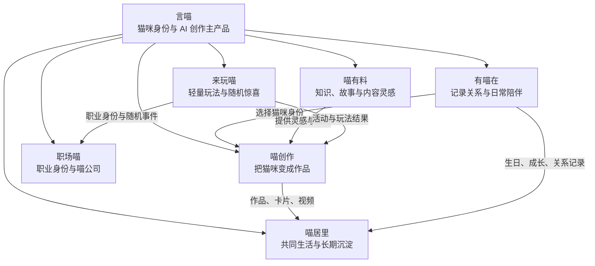

# 人猫关系 AI 创作产品｜产品功能规划 V1.0

> 本文用于把现有战略文档和头脑风暴中的功能，收敛为可执行的产品功能优先级。
>
> 当前规划重点：以“猫咪拍照 → AI 生成异形/创意猫咪图片与内容”为第一优先级主功能；支持一个用户管理多只猫，并在创作时选择对应猫咪身份。

## 一、当前产品主线

产品不以宠物社区、宠物日记或复杂云养成为第一入口，而是先解决一个高频、低负担的问题：

> 用户拍下自家猫咪，选择或直接生成一种有趣表达，几秒钟得到一张真正属于这只猫的 AI 作品。

核心链路：

```text
创建一个或多个猫咪身份
→ 选择本次参与创作的猫咪
→ 拍照或上传照片
→ AI 生成异形/创意猫咪图片与内容
→ 用户选择结果、保存或分享
→ 后续再逐步接入人格、语音、数字猫和其他玩法
```

“故事与共同记忆”暂不承担首版留存主任务，先作为低优先级能力保留。

### 1.1 当前产品模块地图

言喵采用“一个主产品、六个内容模块”的结构，不在当前阶段拆成多个互相跳转的小程序。六个模块共享用户账号、猫咪身份、作品资产和生成能力，但各自承担不同的用户任务。



| 模块 | 核心命题 | 主要功能 | 主要产出 | 当前阶段 |
| --- | --- | --- | --- | --- |
| 喵创作 | 把猫咪变成作品 | 喵喵相机、AI 图片、漫画、喵视频、GIF、创作模板 | 图片、视频、漫画、卡片 | P0 / P0.5 |
| 有喵在 | 让猫咪持续参与生活 | 猫咪档案、人格、喵聊天、日历、语音陪伴、日常记录、喵迹地图 | 猫咪身份、关系记录、互动反馈、流浪猫关怀行迹 | P0.5 / P1 |
| 来玩喵 | 给日常增加一点意外 | 喵老仙、赛博祈福、小游戏、喵币、职业盲盒、随机事件、活动 | 趣味结果、好运签、身份卡、道具和活动记录 | P1 / P2 |
| 喵有料 | 让用户有东西可看、有灵感可用 | 猫咪知识、猫咪翻译、喵笑话、猫咪话本、四季灵感、好物分享 | 内容、行为解读、创作灵感 | P1 / P2 |
| 喵居里 | 把人与猫的生活留下来 | 云上家、照片墙、全家福、家谱、生日场景、纪念空间 | 家庭空间、共同记忆、长期资产 | P2 / P3 |
| 职场喵 | 给猫咪一份有趣的职业身份 | 职业盲盒、喵公司、职场喵剧场、身份卡墙 | 职业卡、公司关系、轻量职场剧情 | P1 / P2 |

### 1.2 六个模块的边界

为避免功能重复，后续按“谁负责什么”划分：

| 模块 | 负责 | 不负责 |
| --- | --- | --- |
| 喵创作 | 生成和编辑作品 | 不承担完整猫咪档案和社区关系 |
| 有喵在 | 管理猫咪身份、关系和日常互动 | 不承担重游戏经济和大型内容流 |
| 来玩喵 | 提供轻游戏、随机事件和趣味活动 | 不承诺真实收益，不做赌博式玩法 |
| 喵有料 | 提供知识、故事、话题和创作灵感 | 不直接替代医疗诊断或专业服务 |
| 喵居里 | 沉淀家庭空间、共同记忆和长期资产 | 不在首版做复杂 3D 家装模拟 |
| 职场喵 | 管理职业身份、喵公司和职场趣味内容 | 不做真实招聘、收益承诺或严肃职业服务 |

模块之间允许互相导流，但不重复建设同一份数据。例如：猫咪身份由“有喵在”维护，喵创作读取；生日由“有喵在”记录，喵居里负责生成生日场景；喵有料提供话题，喵创作负责把话题生成作品；职场喵只维护职业身份和喵公司关系，职业卡可以被喵创作直接做成海报或短片。

### 1.3 命名决策记录

| 时间 | 决策 | 说明 |
| --- | --- | --- |
| 2026-11-20 | 确定六个模块名称 | 喵创作、有喵在、来玩喵、喵有料、喵居里、职场喵 |
| 2026-11-20 | 确定产品结构 | 六个模块统一收纳在言喵主小程序内，暂不拆成产品矩阵 |
| 2026-11-20 | 确定导航原则 | 首页展示模块入口，但底部导航不平铺六个模块，避免产品变成功能商城 |
| 2026-11-20 | 确定子模块承载方式 | 模块选择继续使用底部抽屉，保证快速浏览和返回；进入具体功能后使用独立页面承载复杂内容 |
| 2026-11-20 | 优化子模块入口视觉 | 子模块顶部不重复展示模块标题和说明；卡片采用多种构图变体，图标按功能物件重新生成 |
| 2026-11-20 | 重做底部导航 | 仅保留高频的首页、喵档案、喵创作、喵作、我的；聊天、视频、福利、日历、翻译等场景能力从模块入口进入，不在底栏堆叠 |
| 2026-11-20 | 转开发喵迹地图 | 归入“有喵在”，先做个人私密地图 MVP：照片/视频记录、微信原生定位、约 100 米模糊点位、地图标记和时间线回看；暂不做公开流浪猫地图与救助撮合 |
| 2026-11-20 | 转开发赛博祈福 | 归入“来玩喵”，先做趣味解压 MVP：轻敲电子木鱼、每日好运签、少量喵币消耗和本地状态持久化；不做真实宗教服务、算命或收益承诺 |

## 二、功能优先级总览

| 优先级 | 功能方向 | 当前定位 | 规划判断 |
| --- | --- | --- | --- |
| P0 | 猫咪多身份与档案管理 | 所有功能的身份基础 | 必须首版支持 |
| P0 | 猫咪拍照生成异形/创意图片与内容 | 第一优先级主功能 | 产品核心入口 |
| P0.5 | 猫咪人格与前世今生 | 高优先级角色底座 | 连接内容生成和后续陪伴 |
| P1 | 猫咪翻译 | 通过猫咪视频/猫叫的动作与声音生成趣味解读，并支持把人的话转成喵语播放 | 先做可替换 mock 分析器，再接真实多模态模型 |
| P1 | 喵迹地图 | 记录遇见的流浪猫照片/视频、模糊位置和个人关怀行迹 | 先做个人私密地图 MVP，使用微信原生地图与定位能力 |
| P2 | 赛博祈福 | 用电子木鱼、轻量动效和每日好运签提供陪伴式解压，并形成喵币消耗出口 | 先做本地预览 MVP；文案、视觉和流程按娱乐向包装，后置音效、服务端账本与活动配置 |
| P1 | 数字猫基础形象 | AI 作品之外的角色呈现 | 依赖猫咪身份和人格 |
| P1.5 | 语音陪伴基础版 | 角色互动能力 | 依赖人格设定和音色能力 |
| P1 | 猫咪短视频创作 | 独立核心创作入口与未来商业化方向 | 先做模板化循环短片，再接入 MP4、音频、会员额度和付费增强 |
| P2 | 云上小家 | 长期空间与互动 | 研发复杂度最高，后置 |
| P2 | “懂它”知识窗口 | 辅助理解功能 | 可以有，但不做主版块 |
| P2 | 猫咪时装秀 | 特色创作玩法 | 降低优先级，作为扩展模板 |
| P3 | 故事与共同记忆 | 长期沉淀能力 | 当前整体优先级最低 |
| P3 | 轻社交 | 外部互动与传播 | 暂不作为核心闭环 |
| P3 | 文创与实体纪念物 | 商业化延展 | 等数字资产形成后再做 |

## 三、P0 功能一：多猫身份与档案管理

### 3.1 功能目标

支持一个用户同时拥有、管理和使用多只猫咪身份。不同猫咪拥有独立的档案、外貌特征、性格设定和后续 AI 创作上下文。

产品不能默认“一个用户只有一只猫”，也不能让用户每次创作都重新上传和描述猫咪。

### 3.2 核心能力

#### 创建多个猫咪身份

用户可以依次创建多只猫咪，例如：

- 布丁
- 奶糖
- 小黑

每只猫拥有独立的：

- 名称
- 头像或代表照片
- 性别、年龄等基础信息
- 花色、体型、脸部和身体特征
- 性格关键词
- 日常习惯
- 喜欢和讨厌的事情
- 与主人的相处方式
- 独立的人格设定
- 独立的作品和互动记录

#### 档案管理

用户可以：

- 查看全部猫咪
- 切换当前猫咪
- 编辑猫咪资料
- 增加新的代表照片
- 修改或补充性格、习惯和偏好
- 设置默认猫咪
- 暂时归档某只猫
- 删除猫咪档案

删除操作需要明确提示影响范围。默认不直接删除已经生成的作品，避免用户误删重要内容。

#### 创作前选择猫咪

在进入拍照和生成流程前，用户可以选择本次参与创作的猫咪。

推荐交互：

```text
首页显示当前猫咪头像和名称
→ 点击头像切换猫咪
→ 进入拍照/上传
→ 使用当前猫咪身份生成内容
```

生成结果必须绑定对应的猫咪身份，避免多只猫的外貌、人格和历史信息混用。

#### 支持多猫共同创作

除单猫创作外，后续应支持：

- 两只或多只猫一起出现在一张图片中
- 主人 + 一只猫
- 主人 + 多只猫
- 多只猫的对话、短剧和组合海报

这类作品需要明确记录参与创作的猫咪身份，例如“布丁 + 奶糖”，不能只绑定一个主猫档案。

### 3.3 P0 数据原则

每个生成作品至少需要保存：

| 数据 | 说明 |
| --- | --- |
| 用户 ID | 作品所属用户 |
| 猫咪 ID | 单猫作品对应的猫咪 |
| 猫咪 ID 列表 | 多猫或人猫共同作品 |
| 使用的照片 | 本次生成的输入素材 |
| 生成类型 | 今日喵事、漫画、海报等 |
| 生成结果 | 图片、文案或其他输出 |
| 创建时间 | 便于后续查看和管理 |

### 3.4 首版验收标准

- 一个用户可以创建至少 2 只猫咪。
- 用户可以在首页快速切换当前猫咪。
- 当前猫咪会自动带入拍照和生成流程。
- 生成结果可以识别属于哪只猫。
- 不同猫咪的照片、人格和生成内容不会混用。
- 支持后续扩展为多猫共同创作。

### 3.5 P0 当前开发切片：喵档案基础闭环

本轮先把“猫咪身份可创建、可选择、可回看”跑通，不等待真实登录和照片上传服务，保证体验版可以直接验证核心流程。

| 用户动作 | 当前实现 | 数据边界 | 验收指标 |
| --- | --- | --- | --- |
| 查看猫咪列表 | “我的猫”展示当前主角和全部未归档猫咪 | 本地预览按当前账号/guest 隔离 | 有 2 只猫时可独立展示，当前主角清晰 |
| 创建/编辑档案 | 名字、照片、出生日期、特征、性格、偏好和拟人化设定 | 未登录使用本地存储，登录后走猫咪 API 并合并本地照片 | 建档成功率、重新进入后资料保持 |
| 选择当前主角 | 列表点击卡片切换，进入创作/陪伴功能复用 | `current_cat` 只保存当前猫咪 ID | 切换后首页、聊天、日历和创作选择一致 |
| 查看详情 | 头像、照片集、年龄、猫格、偏好和角色设定 | 原图默认私密，只在用户主动预览时展示 | 详情页与编辑后的资料一致 |
| 生成喵卡片 | 以封面照片为主视觉，叠加名字、年龄、猫格、偏好和口头禅 | 使用 Canvas 生成临时图片，不写入公开内容流 | 生成后可预览、保存到相册和分享图片 |
| 喵卡片扫码分享 | 卡片叠加微信官方小程序码，扫码进入该猫咪的公开档案详情 | 仅用户主动生成分享码；短码 180 天失效，公开接口只返回已分享的猫咪资料 | 登录用户生成成功率、扫码落地成功率、分享页首屏可见率；未登录仍可生成无二维码卡片 |
| 归档 | 管理菜单归档猫咪，已生成作品不删除 | 预览版通过 `archivedAt` 标记；下游选择器过滤归档猫 | 归档后不再出现在日历、聊天、翻译和创作选择 |

实现约束：照片仍保留本地预览路径，真实版本必须改为客户端直传 COS；归档不是物理删除，后续补充恢复入口和删除影响确认；多猫共同创作和家谱不阻塞本轮闭环。

## 四、P0 功能二：猫咪拍照生成异形/创意图片与内容

### 4.1 功能定位

这是当前产品的第一优先级主功能，也是首版最重要的用户价值。

用户不需要先学习复杂的 AI 提示词，也不需要先填写长表单，只需选择猫咪并上传一张照片，就可以获得具有明显创意和分享价值的内容。

“异形猫咪图片”暂作为当前产品用语保留。正式进入设计和开发前，需要进一步明确“异形”具体指：

- 非常规轮廓或构图的猫咪图片；
- 拟人化、角色化或超现实造型；
- 猫咪与主人组合成特殊形态；
- 适合挂件、贴纸和文创制作的异形轮廓；
- 或以上方向的组合。

### 4.2 P0 内容类型

以下内容都归属于“猫咪拍照生成”主功能，而不是互相独立的一级产品模块：

1. 今日喵事
2. 猫咪新闻
3. 猫咪独白
4. 两脚兽观察日记
5. 猫咪语音吐槽
6. 情绪卡片
7. 猫咪语录
8. 猫咪身份证
9. 成长纪念卡
10. 杂志封面
11. 电影海报
12. 猫咪通缉令
13. 猫咪四格漫画
14. 人猫聊天截图
15. 人猫小剧场
16. 人猫双图生成连续漫画
17. 异形/创意猫咪图片

“猫咪语音吐槽”如果首版尚未接入语音合成，可以先生成文字版，语音播放作为后续能力接入。

### 4.3 推荐的首版生成入口

首页不建议展示 17 个平铺入口，而是统一成一个主按钮：

> 拍一拍，生成我家猫的作品

进入后再根据场景提供少量推荐：

- 今日喵事
- 猫咪新闻
- 四格漫画
- 异形创意图
- 杂志封面

其他内容类型通过“换一种玩法”或横向模板选择进入，避免首页变成工具商城。

### 4.4 统一生成流程

```text
选择猫咪
→ 拍照/上传照片
→ 选择一个轻量主题，或直接使用推荐
→ AI 生成 1～4 个结果
→ 用户选择、重新生成、保存或分享
```

首版尽量控制在三步以内，不要求用户输入长文本。

### 4.5 与多猫档案的联动

- 默认使用当前选中的猫咪身份。
- 生成前允许临时增加第二只或多只猫咪。
- 生成结果中可区分每只猫的身份和角色。
- 猫咪新闻、独白、语录和人格化文案使用对应猫咪的性格。
- 同一只猫反复生成时，尽量保持外貌和角色一致。

### 4.6 P0 验收指标

- 首次生成完成率
- 从选择猫咪到得到结果的平均耗时
- 生成成功率
- 用户认为“像我家猫”的比例
- 作品保存率
- 作品分享率
- 用户重新生成或尝试第二种模板的比例

### 4.7 P0.5 喵喵相机趣味模板

喵喵相机在基础美颜闭环上支持“选择模板 → 下载 → 镜头预览 → 拍摄合成”。模板不是单纯的拍后滤镜，而是可以在实时镜头中展示透明装饰图层，让用户在按下快门前就能看到大致成片效果。

首批内置趣味模板：

| 模板 | 镜头效果 | 使用方式 | 优先级 |
| --- | --- | --- | --- |
| 泡泡派对 | 泡泡、爱心、闪光环绕 | 下载后实时叠加，拍后合成 | P0.5 |
| 彩虹蝴蝶结 | 彩虹、蝴蝶结、云朵边框 | 下载后实时叠加，拍后合成 | P0.5 |
| 星月魔法 | 月亮、星球、夜光云朵 | 下载后实时叠加，拍后合成 | P0.5 |
| 皇冠出道 | 皇冠、绶带、出道闪光 | 下载后实时叠加，拍后合成 | P0.5 |

实现约束：

- 模板配置与透明装饰素材分离，方便后续扩展更多模板。
- 用户点击模板后同时下载配置和装饰素材，完成后才标记为“已下载”。
- 实时预览使用原生相机上的 `cover-image` 图层，拍摄后使用 Canvas 合成。
- 预览层与成片层使用同一取景框比例和中心裁剪规则，避免拍摄前后位置漂移。
- 装饰资源使用图片模型生成的透明 WebP，不使用 CSS 绘制图形。
- 首批只做固定位置装饰；需要跟随猫咪脸部的猫耳、眼镜和美妆效果，后续接入宠物识别或美颜 SDK。

验收指标：

- 模板下载完成率不低于基础资源下载成功率。
- 下载完成后重新进入拍摄页，镜头可展示对应装饰。
- 拍后预览包含镜头中看到的装饰，位置误差控制在视觉不可感知范围。
- 弱网下模板下载失败不阻塞拍照，可重试或继续使用基础美颜。

## 4.8 P0.5 用户反馈与共创入口

这是面向早期用户的产品改进闭环，入口放在“我的”页面，分为“问题反馈”和“产品建议”两类，不改变首页主创作路径。

### 4.8.1 首版范围

| 能力 | 说明 | 优先级 |
| --- | --- | --- |
| 问题反馈 | 提交问题标题、复现描述、可选联系方式和截图 | P0.5 |
| 产品建议 | 提交建议标题、想法描述、可选联系方式和截图 | P0.5 |
| 提交回执 | 提交后展示“已收到”和“待处理”状态，内容默认不公开 | P0.5 |
| 本地草案记录 | 预览版按用户隔离保存最近 50 条记录 | P0.5 |

### 4.8.2 交互与隐私约束

- “我的”页提供统一的共创卡片，用户可直接选择问题反馈或产品建议进入表单。
- 描述内容为必填；标题、联系方式和截图为选填，空内容不可提交。
- 截图选择、预览和移除均通过平台适配层完成，用户提交前可确认是否包含隐私。
- 当前预览版使用本地存储模拟提交回执；接入真实工单系统后，改为“提交任务 → 返回工单号 → 查询处理状态”，不在页面同步等待后台处理。
- 后续接入工单 API 时，需补充服务端字段校验、频率限制、敏感信息处理和客服后台，不允许把用户原图直接写入数据库。

### 4.8.3 验收指标

- 从“我的”页进入两类表单均不超过一次点击。
- 两类表单可切换，必填校验、截图预览/移除和重复提交保护有效。
- 提交成功后有明确回执，刷新或重新进入不会影响已保存记录。
- 反馈内容默认仅用户本人可见，不自动进入社区或公开内容流。

## 4.9 P1 喵币福利与活动入口

在“我的”页面增加“每日福利”入口，用产品内喵币连接签到、创作和共创行为，形成轻量的日常回访理由。喵币是言喵内虚拟道具，不设计现金兑换或收益承诺。

### 4.9.1 首版范围

| 能力 | 说明 | 优先级 |
| --- | --- | --- |
| 喵币余额 | 展示当前喵币、累计赚取和今日收益 | P1 |
| 每日签到 | 每日可领取 20 喵币，记录连续签到天数 | P1 |
| 喵币任务 | 开启一次创作奖励 30 喵币；提交一次共创奖励 20 喵币 | P1 |
| 分享裂变奖励 | 分享福利页给新朋友；朋友首次从分享页打开可领取 30 喵币 | P1 |
| 收益记录 | 展示最近 4 条本设备的喵币来源和时间 | P1 |

### 4.9.2 交互与性能约束

- 入口放在“我的”页面，不占用首页主创作入口；点击一次进入福利页。
- 福利页首版仅使用轻量排版和品牌色块，不新增图片或图标资源，避免增加启动包体积。
- 喵币状态按用户隔离保存在本地预览数据中；后续接入真实账本时改为服务端余额和幂等奖励流水。
- 签到不设置中断惩罚，不用现金收益、提现或高刺激弹窗制造压力。
- 福利页支持微信小程序转发和朋友圈分享；分享链接携带一次性邀请码，预览版由本地账本记录领取状态。
- 预览版只奖励被分享者 30 喵币，不把“打开分享页”视为真实注册或现金收益；正式版必须由服务端签发邀请凭证、校验用户身份、限制设备/账号频次并写入喵币流水。
- 真实活动接入前需要补充活动配置、领取频控、异常回滚、审核文案和服务端流水。

### 4.9.3 验收指标

- 从“我的”页进入福利页不超过一次点击，余额和今日状态可见。
- 同一天签到和同一任务不可重复领取，刷新页面后状态保持一致。
- 从福利任务进入创作或共创流程，完成后能回到福利页看到喵币记录。
- 从福利页点击分享，分享路径包含邀请参数；新设备打开后可领取 30 喵币，自己打开自己的分享链接和重复打开不会重复领取。
- 弱网或账本记录失败不阻塞拍照、反馈等主流程。

## 4.10 P1 猫咪翻译

“猫咪翻译”归入“喵有料”，不是医疗诊断工具，也不宣称能够证明真实猫语。用户可以拍摄视频、录一段猫叫，系统结合动作、姿态和声音给出轻松的行为解读；也可以输入或录下人类语言，生成一段适合对猫播放的演示喵声。

### 4.10.1 首版闭环

| 阶段 | 用户体验 | 实现方式 | 优先级 |
| --- | --- | --- | --- |
| 选择素材 | 支持拍摄/相册选择 MP4 视频，或拍摄/相册选择 JPG、PNG、WebP 照片，默认只处理当前猫咪的私密素材 | 小程序适配层调用原生媒体选择能力；视频限制 30 秒 / 50MB，图片复用输入图校验 | P1 |
| 上传 | 显示已选视频/照片、时长或素材类型和私密提示 | 客户端直传 COS，服务端只保存 `assetId` | P1 |
| 分析 | 显示“正在观察这段视频/这张照片”状态，可失败重试 | 当前预览版走 mock 分析器，保留真实多模态模型适配边界 | P1 |
| 猫叫翻译 | 录制 3～15 秒猫叫，返回声音线索和可能诉求 | 复用录音上传与分析接口，音频默认私密 | P1 |
| 人话转喵语 | 输入或录音后生成喵语短句，点击播放给喵听 | 当前预览版播放演示喵声，真实 TTS 作为后续模型适配 | P1 |
| 结果 | 展示一句结论、动作/声音线索、把握度、建议和免责声明 | 结果结构固定，后续替换模型不改页面 | P1 |

### 4.10.2 产品与安全边界

- 结果文案使用“更像是”“可能”“把握度”等不确定表达，不能写成事实结论。
- 页面固定展示“不是医疗诊断，也不能替代兽医判断”；异常行为应引导用户咨询专业人士。
- 视频、照片、声音和猫咪资料默认私密，不进入公共内容流，不默认分享。
- 当前预览版未接入真实视频多模态模型，接口已预留统一的 `assetId → 分析结果` 结构；接入真实模型时必须补充异步任务、额度扣减、失败退款、审核和删除策略。
- 人话转喵语不宣称猫咪一定能理解；当前预览版使用短句转换和演示喵声，真实 TTS 接入后仍需保留“请观察猫咪反应”的提示。
- 入口图标使用图片模型生成的透明 WebP，不用 CSS 绘制图标；视频播放控件使用平台原生能力。

### 4.10.3 验收指标

- 从“喵有料 → 猫咪翻译”到选择视频不超过一次点击，完成分析不超过三步。
- 视频未选择、上传失败、分析失败和网络中断都有可操作的重试或重新选择入口。
- 未登录用户可体验本地演示结果；登录用户走直传和服务端分析接口。
- 页面不把视频字节流传入业务 API；服务端日志不记录视频内容或永久公开地址。
- 真实模型接入前，mock 结果明确标记 `mode=mock`，避免误认为已经具备真实识别能力。

## 4.11 P1 喵日历

“喵日历”归入“有喵在”，首版先解决生日、驱虫、疫苗、体检和自定义事项的记录与回看，不把医疗提醒包装成专业诊疗建议。每条事件必须绑定一只猫咪，支持多猫切换后分别维护。

### 4.11.1 首版闭环

| 阶段 | 用户体验 | 实现方式 | 优先级 |
| --- | --- | --- | --- |
| 查看 | 按月查看日历，点日期查看当天事项 | 42 格月视图，周一作为一周起始，当前日期和有事项日期高亮 | P1 |
| 添加 | 选择事项类型、日期和备注后保存 | 首版本地存储，事件绑定 `catId`；类型包含生日、驱虫、疫苗、体检、其他 | P1 |
| 管理 | 勾选完成、编辑、删除事项 | 页面内完成状态和删除确认，刷新后保持 | P1 |
| 切换猫咪 | 多只猫分别查看各自日历 | 复用猫咪档案和当前猫咪选择，不混用事件 | P1 |

### 4.11.2 约束与后续

- 首版“提醒”指日历内可见的事项提示，不承诺系统级通知；接入订阅消息前需要补充授权、频控、取消和失败重试设计。
- 日历中有安排的日期使用图片模型生成的透明喵 icon 标记，普通日期不显示装饰，避免用 CSS 绘制功能图标。
- 事件、猫咪资料和备注默认私密，不进入公共内容流。
- 后续接入服务端同步时，沿用 `catId`、事件唯一 ID 和幂等更新，避免多端重复创建。

### 4.11.3 验收指标

- 从“有喵在 → 喵日历”进入页面不超过一次点击。
- 新增一条事件不超过三步，保存后立即出现在对应日期和事项列表。
- 切换猫咪后只显示当前猫咪事件，完成/编辑/删除刷新后状态保持。
- 无猫咪档案时给出明确建档入口，不创建无归属事件。

## 4.12 P1 喵迹地图

“喵迹地图”归入“有喵在”，用于记录用户在路边、公园、小区或旅行途中遇见的流浪猫。首版重点是保存个人关怀行迹，不把一次观察误认为一只长期身份，也不默认公开流浪猫位置。

### 4.12.1 首版闭环

| 阶段 | 用户体验 | 实现方式 | 优先级 |
| --- | --- | --- | --- |
| 进入 | 从首页“有喵在”模块进入喵迹地图 | 独立二级页面，使用微信原生 `map` 组件 | P1 |
| 记录素材 | 拍照、拍视频，或从相册选择 | 通过 `utils/adapter.js` 统一调用系统媒体选择；视频限制 30 秒 | P1 |
| 添加位置 | 点击“添加当前位置” | 优先使用微信 `getLocation`，坐标转为 GCJ-02；未授权时引导用户去设置 | P1 |
| 隐私处理 | 保存前提示位置会模糊展示 | 首版只保存约 100 米级模糊坐标，默认 `visibility: private` | P1 |
| 补充记录 | 记录后按需补充行为、备注和临时外号 | 主流程默认使用“随手遇见”，外号最多 20 字、备注最多 80 字；补充信息不阻塞保存 | P1 |
| 回看 | 地图标记 + 我的喵迹时间线 | 点位点击打开详情；支持按全部、本月、照片、视频筛选 | P1 |
| 删除 | 用户主动移除某条记录 | 本地数据删除确认，不影响喵咪档案和作品 | P1 |

### 4.12.2 数据模型与依赖

```js
{
  id: 'trace-xxx',
  mediaType: 'image',
  mediaPath: 'wxfile://...',
  latitude: 31.230,
  longitude: 121.474,
  locationLabel: '当前位置附近',
  nickname: '树下小黑',
  behavior: '晒太阳',
  note: '在树荫下睡了很久',
  visibility: 'private',
  recordedAt: 0,
  createdAt: 0
}
```

- 当前预览版使用按用户隔离的本地 Storage，键名为 `trace_records`；后续接入服务端时仅上传用户主动确认的媒体和模糊坐标。
- 地图使用微信原生 `map` 和 `getLocation`，不新增第三方地图 SDK；地图点位图标使用图片模型生成的透明资源，经 CDN 加载并在需要时缓存到用户临时目录。
- 用户照片和视频属于私密媒体，不放入 `server/public/assets/`；真实云端版本必须走 COS `u/` 前缀、短期授权地址和上传进度。

### 4.12.3 隐私与后续边界

- 默认仅自己可见；首版不做公开地图、附近流浪猫观察点、救助撮合、投喂协作或领养线索。
- 不展示住宅、店铺后门等精确点位；后续若支持分享，必须单独确认公开范围，并默认使用街区级位置。
- 照片和视频保存前提醒检查路人、车牌、门牌等隐私；不鼓励公开稀有猫、幼猫或固定栖息点。
- 后续可增加月份回看、关怀路线和用户主动分享，但不把未经核实的记录标记为救助事实。
- 临时外号只属于这条喵迹记录，不会自动创建正式猫咪档案；用户可在详情中随时修改或清除。

### 4.12.4 验收指标

- 从“有喵在 → 喵迹地图”进入页面不超过一次点击。
- 从点击“记录一只”到保存一条照片喵迹不超过三步；照片、视频、定位失败都有可操作的重试入口。
- 保存后地图出现对应点位，点位详情与时间线内容一致；刷新页面后记录仍然存在。
- 位置默认按约 100 米模糊，记录默认私密；未授权定位时不保存精确位置，也不阻塞用户继续浏览已有喵迹。
- 200 条本地记录内，页面首次打开不超过一次媒体资源预加载；地图点位和列表保持可操作，不因图片加载失败导致页面崩溃。

## 4.13 P2 赛博祈福

“赛博祈福”归入“来玩喵”，定位为睡前、情绪低落或想短暂放空时使用的轻量解压陪伴。它不是宗教服务、算命或真实祈福工具，所有“好运”表达都属于娱乐化内容。

### 4.13.1 首版闭环

| 阶段 | 用户体验 | 实现方式 | 优先级 |
| --- | --- | --- | --- |
| 进入 | 从首页“来玩喵”打开赛博祈福 | 独立二级页面，保持单一顶部导航 | P2 |
| 轻互动 | 小猫自动敲电子木鱼，每次敲击显示“+1 好运值”并累计今日次数 | 使用图片模型生成的黄袍猫、木鱼和香炉主体；动效只使用轻量 transform/opacity，页面隐藏时停止计时 | P2 |
| 上香祈福 | 用户主动消耗 5 喵币，让小猫执行一段上香陪伴动画 | 读取福利页喵币余额；同一天只允许上香一次，余额不足时引导去每日福利 | P2 |
| 查看结果 | 获得一张“今日好运签”，包含可做/先放一放两条轻建议 | 本地内容池按日期选择，结果保存在按用户隔离的本地 Storage | P2 |
| 回访 | 当天再次打开直接回到已开启的结果 | 页面 `onShow` 恢复状态，不重复扣费 | P2 |

### 4.13.2 数据与依赖

```js
{
  date: '2026-11-20',
  woodFishCount: 3,
  blessing: { title: '今天有光', text: '...' },
  totalBlessings: 1
}
```

- 预览版新增 `cyber_blessing_state` 本地状态，与 `welfare_state.coins` 联动；喵币扣除写入福利账本，失败不改变页面结果。
- 运行时视觉资源放入 `server/public/assets/`，通过 CDN 加载；黄袍猫、木鱼、香炉和寺庙夜景由图片模型生成，不用 CSS 绘制正式 icon 或场景图。敲击动作采用五帧 WebP 雪碧图（待机、抬槌、落槌、回收、待机），用 `steps(4)` 固定裁剪窗口播放，首帧和尾帧复用同一张待机图，避免循环切换时跳变和多图片节点反复创建。
- 后续真实版本需要服务端幂等扣费、`credit_ledger` 或喵币账本、内容配置和内容安全审核；AI 或音效能力不得同步阻塞页面。

### 4.13.3 合规与体验边界

- 页面标题可以使用“赛博祈福”，但核心说明统一使用“趣味解压、电子陪伴、每日好运签”等娱乐向表达。
- 不使用真实宗教仪式、算命、占卜、神灵承诺、财富/健康结果承诺等文案，不把好运签当作决策依据。
- 喵币仅为言喵内虚拟道具，不可兑换现金；扣费必须由用户主动点击确认，余额不足不允许负数。
- 默认不要求连续签到、不制造中断惩罚；当天上香结果可反复查看，自动敲击在页面离开后停止，降低耗电和回访成本。

### 4.13.4 验收指标

- 从“来玩喵 → 赛博祈福”进入页面不超过一次点击；首次打开首屏只展示一个主要消耗 CTA。
- 页面打开后小猫自动敲木鱼，每次敲击即时显示“+1 好运值”，页面离开后停止计时；低端设备不出现持续高频动画。
- 余额足够时，让小猫上香只扣 5 喵币一次；余额不足时可直接进入每日福利；刷新和返回后状态保持一致。
- 结果页明确标识娱乐属性；不出现真实祈福、算命、财富或健康保证。
- 本地预览状态按用户隔离，资源加载失败时不阻塞页面，且不把用户隐私媒体上传到公开静态资源目录。

## 五、P0.5 功能三：猫咪人格与前世今生

### 5.1 优先级判断

该功能保留高优先级，放在猫咪档案之后、复杂陪伴功能之前。

它不是一个孤立的故事彩蛋，而是后续内容生成、数字猫、语音陪伴和短视频角色一致性的基础。

### 5.2 推荐流程

```text
创建猫咪档案
→ AI 生成 3 种前世人物故事
→ 用户选择或轻量调整
→ 确认今生性格与说话方式
→ 生成猫咪角色设定书
```

### 5.3 角色设定内容

- 前世人物身份
- 前世经历
- 性格来源
- 来到主人身边的故事
- 与主人的关系定位
- 喜欢和讨厌的事情
- 说话方式和口头禅
- 情绪表达方式
- 推荐音色
- 适合生成的内容主题

### 5.4 功能边界

必须明确这是拟人化故事设定，不是真实轮回证明，也不是真正的猫语翻译。产品可以提供情绪代入，但不能把 AI 角色包装成现实诊断或事实判断。

## 六、根据开发难度排序的陪伴与空间功能

用户已确认：云上小家、数字猫、语音陪伴和 AI 宠物短视频不按想象价值直接排序，而要结合开发难度、基础依赖和生成成本决定。

### 6.1 数字猫：P1

先做轻量版本：

- 使用猫咪档案生成数字猫头像或角色卡
- 在首页展示当前猫咪
- 根据人格设定展示简单状态和文案
- 与猫咪作品、人格设定关联

暂不做复杂养成、复杂动作和大型场景。

### 6.2 语音陪伴：P1.5

建议先做：

- 6～10 个预设音色
- 按住说话
- 猫咪根据人格设定回复
- 猫咪语音吐槽
- 语音播放和文字同步展示

实时双向对话、低延迟打断、复杂情绪表达放到后续版本。

### 6.3 猫咪短视频创作：P1

短视频从 GIF/表情的附属玩法中独立出来，作为首页核心创作入口。它同时承担三个目标：让猫咪内容更容易传播、建立连续创作习惯、为后续会员额度和高级视频能力提供变现承载。

当前基础版先采用“围绕猫咪照片与日常 → 可循环短片”的轻量方案，避免在没有稳定视频供应商、成本控制和内容审核之前直接承诺完整 MP4 工作流。

依赖：

- 视频生成成本更高
- 生成耗时更长
- 角色连续性更难保证
- 需要生成内容标识和内容安全审核
- 需要控制免费次数和算力成本
- 需要稳定的视频/动图生成服务、异步任务、原图存储和下载分享链路

当前验收指标：

- 首页可以在 1 次点击内进入短视频创作。
- 用户可以使用模板或自定义剧情完成一次短片提交。
- 生成任务必须具备等待、失败、重试、额度扣除与失败退还状态。
- 成功结果可以保存到作品、下载和分享，并使用原始媒体资源。
- 首批模板覆盖 Vlog、变装、打工猫、开箱、侦探和奇幻变身等不同叙事类型。

后续商业化方向：

- 更长时长、更高分辨率和 MP4 导出
- 配乐、字幕、封面和多镜头剪辑
- 角色一致性增强、批量生成和系列化创作
- 会员额度、模板包和高级视频模型

### 6.4 云上小家：P2

云上小家研发复杂度最高，涉及：

- 家庭空间识别
- 布局风格化生成
- 数字猫在场景中的位置和动作
- 家具、装饰物和作品资产管理
- 前端空间展示和互动逻辑

建议先做静态或半动态版本：

- 根据用户照片生成一张“像我家”的风格化房间图
- 将数字猫放入房间
- 将作品作为相框、海报或书架内容展示

完整互动空间、养成系统和复杂 3D 场景暂不进入早期版本。

### 6.5 难度与优先级结论

```text
数字猫基础形象
→ 语音陪伴基础版
→ AI 宠物短视频
→ 云上小家互动版
```

## 七、P2 辅助功能：懂它

### 7.1 产品定位

“懂它”可以保留，但不作为主版块功能，不进入首页底部主导航。

它更适合作为：

- 猫咪档案中的辅助入口
- 生成结果页的延展入口
- 用户查看某个行为时的解释工具
- 语音或文字问答入口

### 7.2 保留的核心能力

- 今日懂它
- 猫咪行为和情绪解释
- “我想知道”文字/语音问答
- 基于当前猫咪档案提供个性化解释
- 将观察结果保存回猫咪档案

不做完整宠物百科、宠物资讯信息流或医疗问诊平台。

### 7.3 安全边界

- 不替代兽医诊断。
- 不根据单张照片直接判断疾病。
- 出现明显异常时建议及时就医。
- 健康内容需要可靠资料或专业人员审核。

## 八、P2 功能：猫咪时装秀

猫咪时装秀保留为扩展创作玩法，但优先级调低，不承担首版主入口任务。

后续可以作为“猫咪拍照生成”中的一个内容模板：

- 一次生成多套造型
- 主题秀场
- 造型海报
- 杂志封面
- 数字衣橱
- 后续关联实体挂件和周边

首版不优先做投票榜单、复杂衣橱和公开秀场社区。

## 九、最低优先级：故事与共同记忆

故事与共同记忆整体调整为最低优先级。以下功能暂不作为主版本核心：

- 人猫日记
- 作品时间线
- 连载故事
- 月度回顾
- 年度回忆册
- 自动整理共同生活事件
- 纪念册和故事长卷

但为了不影响基础体验，P0 可以保留非常轻量的“最近生成记录”，仅用于用户找回刚刚生成的作品。这不等于完整的故事与共同记忆系统。

后续再根据用户真实行为判断是否建设完整记忆体系：

1. 用户是否会主动保存作品；
2. 用户是否会重复查看旧作品；
3. 用户是否愿意补充纪念日和生活事件；
4. 用户是否愿意为漫画册、纪念册等付费。

## 十、暂不作为核心的其他功能

### 轻社交

- 喵星邮局
- 匿名串门
- 主题照片墙
- 轻量投票
- 猫咪角色卡交换

先保留为后续增长方向，不进入首版主导航。

### 文创与实体化

- 人猫异形挂件
- 表情包和贴纸
- 漫画册
- 日历
- 潮玩和摆件
- NFC/二维码语音挂件

这些功能需要建立稳定的猫咪身份和生成资产后再做。

## 十一、建议的首版导航与页面结构

首版导航不建议把六个模块全部做成底部 Tab，建议围绕“当前猫咪 + 喵创作”组织：

1. 首页：当前猫咪 + 喵创作主入口 + 六个模块卡片
2. 喵创作：拍照、上传、模板、AI 图片、漫画和喵视频
3. 有喵在：多猫档案、切换猫咪、人格设定、聊天和日常记录
4. 作品：所有模块产生的图片、视频、卡片和长期记录
5. 我的：账号、隐私、素材、额度和设置

“来玩喵”“喵有料”“喵居里”和“职场喵”先从首页模块卡片进入；其中喵老仙归属“来玩喵”，四季模板既可以从“喵有料”浏览，也可以在“喵创作”中直接使用。短视频属于“喵创作”，职业盲盒、喵公司和职场喵剧场归入“职场喵”，暂不单独拆成产品。

## 十二、当前版本的开发顺序

### 阶段一：P0 核心创作闭环｜喵创作 + 有喵在基础

- 有喵在：多猫身份与档案管理
- 当前猫咪切换
- 喵创作：猫咪拍照/上传
- 喵创作：AI 异形/创意猫咪图片生成
- 今日喵事及核心内容模板
- 生成结果查看、重新生成、保存、分享
- 最近生成记录

### 阶段二：P0.5 角色身份｜有喵在增强

- 前世今生
- 猫咪性格设定
- 说话方式与口头禅
- 角色设定书
- 角色设定与内容生成联动

### 阶段三：P1 轻量数字陪伴与趣味入口｜有喵在 + 来玩喵

- 数字猫基础形象
- 基础音色
- 按住说话
- 猫咪语音回复
- 来玩喵：喵老仙趣味起卦
- 来玩喵：赛博祈福轻敲木鱼、每日好运签和喵币消耗 MVP
- 来玩喵：轻量随机事件和每日趣味反馈
- 职场喵：职业盲盒与身份卡墙的规则验证

### 阶段四：P1/P1.5 内容与创作扩展｜喵创作 + 喵有料

- 喵创作：猫咪短视频 MP4 与多镜头版本
- 短视频配乐、字幕和封面
- 会员额度与高级模板
- 喵有料：猫咪知识、喵笑话和猫咪话本
- 喵有料：猫咪翻译最小闭环（拍视频 → 动作/声音解读 → 趣味结果）
- 喵有料：四季视觉模板和创作话题
- 喵有料：好物分享的内容试验
- “懂它”辅助入口归入喵有料
- 猫咪时装秀模板
- 职场喵：喵公司和职场喵剧场的轻量内容原型

### 阶段五：P2/P3 长期空间与资产｜喵居里

- 喵居里：云上小家静态版
- 喵居里：照片墙、全家福和猫咪家谱
- 喵居里：生日场景与共同记忆
- 喵居里：私密纪念空间
- 轻社交
- 文创和实体纪念物

## 十三、当前必须确认的产品问题

1. “异形猫咪图片”最终具体指哪几类视觉结果？
2. 首版是否支持一张照片同时识别多只猫？
3. 多猫共同创作是否在首版开放，还是先只做单猫切换？
4. 猫咪前世今生是首次建档必做，还是用户主动开启？
5. 猫咪语音吐槽首版先做文字，还是直接接入语音合成？
6. 生成作品是否默认保存，还是默认私密且由用户主动保存？
7. “最近生成记录”保留多长时间，是否占用用户云空间？

这些问题会影响首版交互、AI 成本、数据结构和开发范围，应在进入 UI 和技术拆解前确定。
