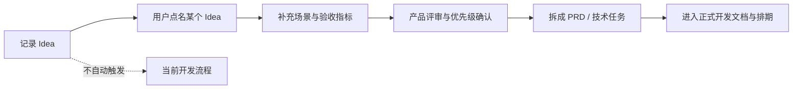
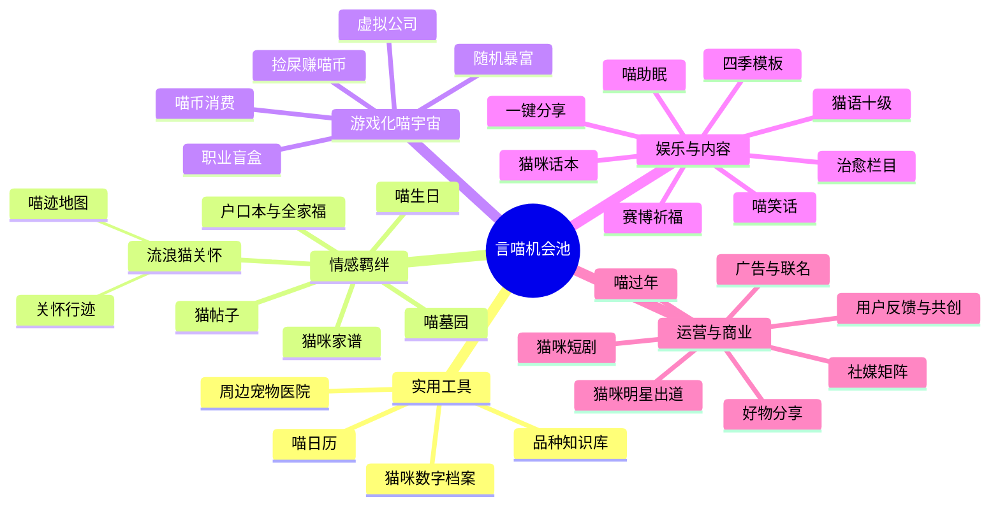
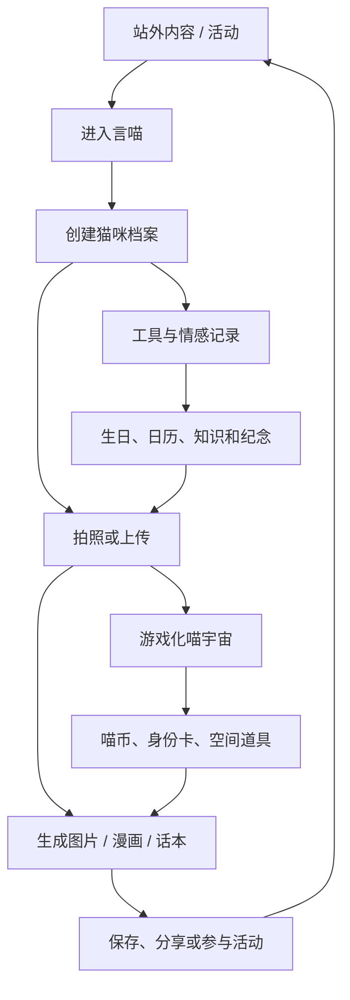

# 言喵产品头脑风暴库

> 文档类型：产品想法存档 / 头脑风暴池  
> 创建时间：2026-11-20  
> 当前状态：持续收集，未自动进入开发排期  
> 维护原则：先记录，再判断；先保留想象空间，再决定是否收敛。

## 重要边界

本文件是“想法仓库”，不是 PRD、不是需求验收标准，也不是开发任务清单。

- 产品开发不会自动识别、解析或执行本文件中的 Idea。
- 只有用户明确提出“开发 / 排期 / 参考 Idea-xxx”时，才从本文件提取对应想法。
- 被点名的想法仍需经过产品判断、隐私评估、技术拆解、优先级确认和验收指标补充。
- 本文件中的优先级是头脑风暴阶段的建议，不会覆盖《产品功能规划.md》中的正式优先级。
- 所有未验证的用户需求、商业判断和增长假设，均视为待验证假设。

## 如何使用这份文档

### 从想法到开发的手动流程

### 点名开发时建议这样说

> 参考 `GAME-001 捡屎官日常`，按 P1 做一个最小可玩版本，先产出产品方案和交互，不立即接支付。

收到明确指令后，再把对应 Idea 转入正式产品文档，并记录“转开发时间”和“采用的版本”。

## 产品机会地图

## Idea 总览

| ID | 功能板块 | Idea 名称 | 一句话描述 | 预期价值 | 建议阶段 | 状态 |
| --- | --- | --- | --- | --- | --- | --- |
| TOOL-001 | 实用工具 | 猫咪数字档案 | 用标签、日记和健康记录维护每只猫的完整资料 | 高频使用、身份底座 | P0/P1 | 想法收录 |
| TOOL-002 | 实用工具 | 喵日历 | 提醒驱虫、疫苗、体检、生日等自定义事件 | 提升留存与照护价值 | P1 | 已转开发，先做本地记录闭环 |
| TOOL-003 | 实用工具 | 品种知识库 | 提供猫咪品种与养护知识 | 降低养猫信息获取成本 | P2 | 想法收录 |
| TOOL-004 | 实用工具 | 周边宠物医院 | 基于位置提供附近宠物医院和服务信息 | 紧急场景价值高 | P2 | 想法收录 |
| CARE-001 | 流浪猫关怀 | 喵迹地图 | 随手记录遇见的流浪猫，用照片、视频和位置留下个人关怀行迹 | 情感记录、公益感、地图留存和回访 | P1 | 已转开发，先做个人私密地图 MVP |
| EMO-001 | 情感羁绊 | 猫咪家庭关系 | 生成户口本、全家福和多猫家谱 | 增加家庭归属感 | P2 | 想法收录 |
| EMO-002 | 情感羁绊 | 喵生日活动 | 为猫咪提供专属庆生仪式与互动 | 强化纪念和分享 | P1/P2 | 想法收录 |
| EMO-003 | 情感羁绊 | 喵墓园 | 为离开的猫咪提供私密纪念空间 | 承载长期情感价值 | P3 | 谨慎收录 |
| EMO-004 | 情感羁绊 | 猫帖子互动 | 围绕猫咪日常进行轻量交流 | 丰富内容生态 | P3 | 想法收录 |
| GAME-001 | 游戏化 | 捡屎官日常 | 每日随机寻找猫咪“粑粑”，换取喵币 | 提供日活和趣味启动器 | P1 | 待验证 |
| GAME-002 | 游戏化 | 职业身份盲盒 | 随机获得猫咪职业、学历和财富身份卡 | 增加惊喜与收集欲 | P1 | 待验证 |
| GAME-003 | 游戏化 | 模拟职场 | 创建虚拟公司，让猫咪入职并互动 | 形成长期玩法 | P2 | 想法收录 |
| GAME-004 | 游戏化 | 随机暴富 | 在虚拟经济中加入轻度随机事件 | 制造不确定性和爽感 | P2 | 谨慎收录 |
| GAME-005 | 游戏化 | 喵币消费闭环 | 用喵币兑换道具或周边好物 | 形成资源消耗和商业接口 | P2/P3 | 依赖较多 |
| UGC-001 | 内容生态 | 治愈栏目与喵笑话 | 提供短内容、猫咪笑话和情绪放松内容 | 降低使用门槛、提升回访 | P1 | 想法收录 |
| UGC-002 | 内容生态 | 喵助眠 | 呼噜声、白噪音和沉浸式陪伴 | 拓展夜间使用场景 | P2 | 想法收录 |
| UGC-003 | 内容生态 | 四季视觉模板 | 提供春夏秋冬风格的图文、图片和视频模板 | 支撑持续创作和分享 | P1 | 可拆分验证 |
| UGC-004 | 内容生态 | 猫咪话本 | 用抽象、荒诞、搞怪设定生成猫猫文学和小剧场 | 形成 UGC 传播素材 | P1/P2 | 待验证 |
| UGC-005 | 内容生态 | 一键外部传播 | 将作品快捷发布到外部社交平台 | 带来站外传播与拉新 | P1 | 依赖平台能力 |
| KNOW-001 | 知识互动 | 猫语十级 | 通过动作和体态竞猜，让用户把猫咪行为翻译成情绪或诉求 | 寓教于乐、知识联动、提高日活 | P1 | 待验证 |
| KNOW-002 | 知识互动 | 猫咪翻译 | 用户拍摄视频或录猫叫，由 AI 结合动作、姿态和声音生成趣味解读；也可把人的话转成喵语播放给猫听 | 降低观察门槛、增加互动和内容分享 | P1 | 已转开发，先做 mock 闭环 |
| GAME-006 | 游戏化陪伴 | 赛博祈福 | 以猫咪陪伴、木鱼和每日好运签包装轻量减压互动 | 情绪价值、日常回访、喵币消耗出口 | P2 | 谨慎收录 |
| OPS-001 | 运营活动 | 猫咪明星出道 | 报名、展示和社区投票选出猫咪明星 | 制造话题和裂变 | P2 | 想法收录 |
| OPS-002 | 商业内容 | 好物分享 | 分享周边和猫咪好物，前期不直接带货 | 积累信任与选品口碑 | P2 | 想法收录 |
| OPS-003 | 商业内容 | 社媒账号矩阵 | 运营站外账号和内容矩阵导流 | 放大品牌触达 | P2/P3 | 运营设想 |
| OPS-004 | 商业内容 | 猫咪短剧矩阵 | 以猫咪为主角制作短剧，植入产品或品牌 | 兼顾内容增长与商业化 | P2/P3 | 运营设想 |
| OPS-005 | 节日运营 | 喵过年 | 以春节换肤、拜年内容、限定任务和轻游戏组成季节活动矩阵 | 拉新裂变、节日促活、内容分享 | P1/P2 | 可拆分验证 |
| OPS-006 | 产品基础设施 | 用户反馈与共创 | 提供问题反馈、产品建议和共创激励入口 | 缩短反馈闭环、提升早期用户参与感 | P0.5 | 可拆分验证 |

## 详细想法卡片

### TOOL｜实用工具

| ID | 用户场景 | 核心体验 | 关键依赖 | 风险与注意事项 | 下一步验证 |
| --- | --- | --- | --- | --- | --- |
| TOOL-001 | 用户想长期记录一只或多只猫 | 创建猫咪档案，添加品种标签、照片、日记和健康记录 | 猫咪身份体系、私密存储 | 资料涉及隐私，不能默认公开；多猫数据不能串 | 访谈确认用户最常记录的 3 类信息 |
| TOOL-002 | 用户忘记驱虫、疫苗或生日 | 设置事件，到期前收到提醒 | 猫咪档案、通知能力 | 避免制造医疗建议；提醒内容要允许用户自定义 | 先做生日和驱虫两个事件的本地提醒原型 |
| TOOL-003 | 用户想快速了解猫咪品种或照护知识 | 按品种、年龄和问题检索卡片 | 内容审核、知识库 | 不把 AI 回答当作诊疗结论；内容需标明来源和更新时间 | 先整理 10 个高频品种和 20 个常见问题 |
| TOOL-004 | 用户遇到紧急就医或想找附近服务 | 根据位置查看周边宠物医院 | 地理位置授权、地图服务 | 位置是敏感信息；必须主动授权并允许关闭 | 先验证用户是否愿意开启位置，以及最需要哪些服务字段 |

### CARE｜流浪猫关怀与喵迹地图

| 字段 | 记录 |
| --- | --- |
| Idea ID | CARE-001 |
| 记录时间 | 2026-11-20 |
| 建议名称 | 喵迹地图 / 流浪猫关怀记录 |
| 用户场景 | 用户在路边、公园、小区或旅行途中遇见流浪猫，想随手拍照/拍视频记录它的可爱行为，也想把自己曾经关心过这些猫咪的记忆保留下来 |
| 核心体验 | 拍照或拍视频 → 添加当前位置 → 补充当时看到的行为、外观和一句话记录 → 生成个人流浪猫地图；之后在地图上看到带经典照片的猫咪标记，并按时间回看自己的关怀行迹 |
| 地图标记 | 每次记录形成一个地图点，默认展示经典照片缩略图、记录日期、地点名称/模糊位置、行为标签和简短备注；同一地点或相近时间的记录支持聚合，避免地图被密集点位挤满 |
| 个人回顾 | 支持“我遇见过的猫”“我的关怀路线”“按月份回看”“最近一次记录”等视图，让地图既像照片地图，也像个人公益打卡轨迹 |
| 可选记录字段 | 照片/视频、记录时间、地点名称、定位精度、猫咪外观标签、行为标签（晒太阳、撒娇、睡觉、玩耍等）、当时心情、备注、是否愿意公开 |
| 后续想象 | 在用户主动公开后，可形成附近流浪猫观察点或关怀地图；后续再评估补水、投喂、绝育救助、领养线索等协作功能，不把未经核实的点位当成救助事实 |
| 关键依赖 | 手机定位授权、地图 SDK、照片/视频上传与压缩、COS 媒体存储、缩略图、地图点位聚合、时间线、隐私设置和内容审核 |
| 隐私与安全边界 | 默认仅自己可见；公开时默认使用模糊位置或街区级位置，不展示住宅、店铺后门等精确点位；照片和视频需提示检查路人、车牌、门牌等隐私；不鼓励暴露稀有猫、幼猫或固定栖息点，避免被骚扰、捕捉或恶意投喂 |
| 数据原则 | 流浪猫记录与用户自己的“喵档案”分开，不强制给陌生猫建立身份；可用匿名记录或用户自定义昵称，避免把一次观察误认为同一只猫的长期档案 |
| 建议阶段 | P1/P2 |
| 状态 | 想法收录，不自动进入开发 |
| MVP 验证 | 先做“单次记录 + 照片 + 模糊位置 + 地图标记 + 时间线回看”的个人闭环，不做公开社区、救助撮合和复杂路线分享 |
| 验证指标 | 首次记录完成率、7 日内再次打开地图比例、每位用户的有效记录数、地图点位回看率、用户对位置模糊和隐私提示的接受度 |

### KNOW｜猫咪知识互动

| ID | 用户场景 | 核心体验 | 关键依赖 | 风险与注意事项 | 下一步验证 |
| --- | --- | --- | --- | --- | --- |
| KNOW-002 | 用户想知道猫咪刚才为什么这么叫、这么动，也想用喵声回应它 | 拍摄/上传视频或录制猫叫，生成“更像是……”的趣味解释；输入或录音人话后生成喵语短句并播放 | 视频/音频选择、私密媒体直传、多模态 AI、TTS、结果审核 | 不能宣称真实翻译猫语或诊断疾病；视频和声音默认私密；模型不确定时要明确表达 | 先用 mock 结果和演示喵声验证用户是否愿意双向互动 |

### EMO｜情感羁绊

| ID | 用户场景 | 核心体验 | 关键依赖 | 风险与注意事项 | 下一步验证 |
| --- | --- | --- | --- | --- | --- |
| EMO-001 | 多猫家庭想表达彼此关系 | 生成猫咪户口本、全家福和家谱 | 多猫身份、关系模型、生成模板 | 关系标签应由用户确认，不能替用户定义家庭关系 | 用 3 个多猫家庭案例测试关系编辑方式 |
| EMO-002 | 用户想给猫过生日或纪念日 | 进入专属庆生场景，生成祝福、卡片和互动 | 喵日历、模板生成、分享 | 不强制打卡，不把庆生变成付费门槛 | 先做“生日卡片 + 一键分享”两步闭环 |
| EMO-003 | 用户需要安放对离世猫咪的思念 | 私密纪念空间、照片、文字和纪念日 | 私密存储、长期数据保留、内容审核 | 情绪敏感；入口和文案要克制，不能游戏化消费悲伤 | 先做低曝光的私密纪念页概念验证 |
| EMO-004 | 用户希望看到其他猫咪的日常 | 轻量发帖、评论和猫咪主题互动 | 内容审核、举报屏蔽、隐私设置 | 社区会显著增加审核与运营成本 | 先用专题活动墙验证内容供给，不直接做完整社区 |

### GAME｜游戏化与喵宇宙经济

| ID | 用户场景 | 核心体验 | 关键依赖 | 风险与注意事项 | 下一步验证 |
| --- | --- | --- | --- | --- | --- |
| GAME-001 | 用户每天想获得一个轻松的打开理由 | 在首页或云上空间寻找随机“粑粑”，点击拾取获得喵币 | 首页空间、随机事件、喵币账本 | 不能变成强制签到；产出上限和防刷机制必须明确 | 做 7 天纸面测试，观察用户是否觉得有趣而非尴尬 |
| GAME-002 | 用户喜欢收集和分享猫咪身份 | 盲盒随机得到职业、学历、初始财富等猫咪身份卡 | 卡池、概率展示、收集册 | 涉及随机抽取时要展示规则，避免诱导未成年人消费 | 先做免费非付费卡池，验证分享率和重复接受度 |
| GAME-003 | 用户希望让猫咪“生活在另一个世界” | 猫咪入职虚拟公司，发生轻量职场事件 | 猫咪身份卡、喵币、云上空间 | 玩法较重，容易偏离产品核心创作体验 | 先做单人、单公司、3 个事件的低成本原型 |
| GAME-004 | 用户喜欢意外、反转和爽感 | 触发随机暴富、破产、升职或意外事件 | 经济系统、风控、事件池 | 不能模仿赌博，不做真实金钱兑换的随机收益 | 先用纯剧情事件，不关联真实支付 |
| GAME-005 | 用户需要消耗喵币获得反馈 | 购买虚拟道具、空间装饰或兑换活动权益 | 喵币账本、商城、兑换规则 | 虚拟货币不可无上限产出；真实兑换需要成本和合规评估 | 先验证 3 个纯虚拟道具的使用意愿 |

### UGC｜娱乐治愈与内容生态

| ID | 用户场景 | 核心体验 | 关键依赖 | 风险与注意事项 | 下一步验证 |
| --- | --- | --- | --- | --- | --- |
| UGC-001 | 用户疲惫时只想看点轻松内容 | 打开即看到喵笑话、治愈短内容或猫咪口吻段子 | 内容池、推荐策略、审核 | 避免内容重复和情绪过度打扰 | 先做 30 条人工精选内容，测试次日回访 |
| UGC-002 | 用户睡前需要陪伴和放松 | 播放猫咪呼噜声、白噪音和轻动画 | 音频版权、后台播放、计时器 | 不能暗示治疗失眠；音频资源需有授权 | 先用 3 种音景验证播放时长和收藏率 |
| UGC-003 | 用户希望持续创作但不想写提示词 | 按季节选择视觉模板，自动套用猫咪照片和文案 | AI 创作、模板资源、作品保存 | 模板不能只换颜色，要有明确创作结果 | 先做四季各 2 个模板，观察完成率和分享率 |
| UGC-004 | 用户想写荒诞、搞怪的猫咪故事 | 输入一个关键词，生成猫咪话本或小剧场 | AI 文案、图片/漫画生成、内容审核 | 需要防止生成攻击、隐私和不当内容 | 先做“关键词 → 三段小剧场 → 图片卡片”原型 |
| UGC-005 | 用户想把作品带到外部平台 | 生成适配不同平台尺寸的图片和文案 | 平台分享能力、版权提示、隐私确认 | 分享必须主动触发；默认作品私密 | 先支持保存图片和系统分享，再评估平台直发 |

### OPS｜运营活动与商业矩阵

| ID | 用户场景 | 核心体验 | 关键依赖 | 风险与注意事项 | 下一步验证 |
| --- | --- | --- | --- | --- | --- |
| OPS-001 | 用户希望自己的猫被更多人看见 | 报名猫咪明星活动，展示作品并参与投票 | 内容社区、投票、反作弊、审核 | 投票公平和未成年人保护；不能把猫咪价值等同于排名 | 先做一次主题征集，不接现金奖励 |
| OPS-002 | 用户想了解值得买的猫咪用品 | 浏览真实使用感和猫咪好物分享 | 内容审核、商品信息、利益披露 | 前期坚持纯分享，不能伪装广告或医疗推荐 | 先用编辑精选 + 用户投稿测试内容可信度 |
| OPS-003 | 产品需要低成本获得外部曝光 | 运营多个社媒账号，发布猫咪内容和产品玩法 | 内容生产、账号管理、品牌规范 | 不做虚假用户故事，不复制用户隐私素材 | 先选 1 个主账号和 1 个内容栏目 |
| OPS-004 | 品牌需要长期内容和商业化载体 | 制作猫咪短剧，植入模板、道具或联名 | 视频生产、版权、商业合作 | 广告需明确标识，避免破坏陪伴感 | 先产出 3 集无商业植入样片测完播率 |

## 本轮新增灵感｜2026-11-20

> 本节仅作为头脑风暴收录，不自动进入开发。四个想法分别覆盖知识互动、日常陪伴、节日运营和反馈基础设施。

### KNOW-001｜猫语十级：体态翻译挑战

| 字段 | 记录 |
| --- | --- |
| 用户场景 | 用户想更懂猫咪，又希望获得轻松的互动，而不是阅读长篇科普 |
| 核心玩法 | 随机展示飞机耳、踩奶、慢眨眼、炸毛、露肚皮等动作或微表情，用户竞猜猫咪的情绪或诉求 |
| 正向反馈 | 猜对后解锁行为知识卡、少量喵币或趣味称号，并关联猫咪品种知识库 |
| 猜错反馈 | 少量喵币扣除，或触发猫咪背对、翻白眼、哄猫任务等非强制搞笑彩蛋；不做挫败性惩罚 |
| 产品闭环 | 竞猜 → 即时解释 → 知识卡收藏 → 记录“我家猫的特点” → 后续个性化推荐 |
| 关键依赖 | 动作/体态图片或视频题库、知识审核、猫咪档案、喵币账本、轻量动画 |
| 风险与边界 | 不能把单张照片判断当作诊断；健康相关内容要给出观察提示和就医边界；答案允许存在不确定性 |
| 建议阶段 | P1 |
| 状态 | 待验证 |
| 下一步验证 | 先做 10 道人工题库，测试答题完成率、收藏率和用户是否觉得“有趣而不说教” |

### GAME-006｜赛博祈福：猫咪修行陪伴

| 字段 | 记录 |
| --- | --- |
| 用户场景 | 用户需要一个睡前或情绪低落时可以打开的轻量解压陪伴场景 |
| 核心玩法 | 黄袍小猫自动敲木鱼，每敲一次累计 +1 好运值；用户可消耗虚拟喵币让小猫上香、点亮每日好运签，但不对应真实宗教服务 |
| 情绪反馈 | “功德+1”“猫主子保佑”“今日好运已被喵喵签收”等轻松、治愈、非严肃文案 |
| 可扩展玩法 | 与喵助眠结合，支持呼噜声、静心计时、猫咪闭眼动画和护身符/好运贴纸收集 |
| 产品闭环 | 每日打开 → 黄袍小猫自动敲木鱼 → 用户消耗少量虚拟喵币让小猫上香 → 获得好运签 → 分享或继续陪伴 |
| 关键依赖 | 虚拟经济账本、动画资源、音效、每日内容池、活动配置 |
| 合规边界 | 统一包装为趣味解压、电子陪伴和娱乐向好运签；避免算命、占卜、真实祈福、宗教仪式暗示和封建迷信导向 |
| 建议阶段 | P2 |
| 状态 | 已转开发：P2 MVP |
| 下一步验证 | 已转为寺庙夜景 + 黄袍小猫自动敲木鱼 + 喵币上香的本地 MVP；继续观察小范围审核、喵币消耗接受度和次日回访 |

### OPS-005｜喵过年：春节活动矩阵

| 字段 | 记录 |
| --- | --- |
| 用户场景 | 春节期间用户愿意制作拜年内容、参与限定任务，并把猫咪作品分享给家人和猫友 |
| 视觉主题 | 红火喜庆皮肤、春联、灯笼、烟花、财神猫和舞狮猫，保持言喵的圆润贴纸风格 |
| 社交工具 | 春节限定表情包、猫咪替用户拜年动态贺卡、拜年语录和适配聊天分享的图片模板 |
| 促活玩法 | 节日签到、分享、互动任务；接猫粮元宝、躲年兽等轻量小游戏；限定喵币、装扮或福袋 |
| 产品闭环 | 进入活动 → 选择猫咪/模板 → 生成拜年内容 → 分享 → 回流领取节日奖励 |
| 关键依赖 | 节日素材、模板配置、活动任务系统、分享链路、反作弊、内容审核 |
| 风险与边界 | 虚拟喵币红包要明确是平台道具；真实现金红包、实物抽奖和奖品活动上线前需要单独合规评估 |
| 建议阶段 | P1/P2 |
| 状态 | 可拆分验证 |
| 下一步验证 | 先做春节拜年卡 + 2 个节日模板 + 1 条分享任务，不接现金红包和复杂抽奖 |

### OPS-006｜用户反馈与共创入口

| 字段 | 记录 |
| --- | --- |
| 用户场景 | 用户遇到 Bug、体验问题，或有功能许愿和猫咪玩法脑洞时，需要低成本告诉产品团队 |
| 核心入口 | 个人中心/设置页固定提供“问题反馈”和“产品建议”两个入口 |
| 问题反馈 | 支持问题分类、文字描述、截图/日志、联系方式和处理状态；默认不公开用户内容 |
| 产品建议 | 支持功能许愿、脑洞投稿、场景描述和期望价值，允许用户查看已采纳的共创内容 |
| 共创激励 | 有效 Bug 或被采纳建议可获得少量喵币、限定徽章或感谢卡；不承诺必然采纳和现金回报 |
| 产品闭环 | 提交 → 自动回执 → 人工归类 → 状态更新 → 采纳/修复反馈 → 共创荣誉沉淀 |
| 关键依赖 | 反馈表单、图片上传、工单/标签系统、隐私说明、人工运营后台 |
| 风险与边界 | 不收集不必要的敏感个人信息；截图可能包含隐私，上传前提示脱敏；激励规则透明，避免诱导刷反馈 |
| 建议阶段 | P0.5 |
| 状态 | 可拆分验证 |
| 下一步验证 | 先做“问题反馈 + 产品建议”两页表单和人工处理台账，不做复杂积分体系 |

## 核心循环假设

| 循环 | 主要入口 | 用户得到什么 | 产品得到什么 | 当前判断 |
| --- | --- | --- | --- | --- |
| 内容传播循环 | 猫咪话本、四季模板、短剧、活动 | 可分享的猫咪作品 | 站外曝光与新用户 | 最适合验证传播 |
| 工具留存循环 | 猫咪档案、喵日历、知识库 | 更好地照顾和记录猫咪 | 高频回访与身份数据 | 适合作为长期基础 |
| 情感沉淀循环 | 生日、家谱、墓园、记忆 | 关系记录与仪式感 | 长期情感价值 | 需要克制设计 |
| 游戏活跃循环 | 捡屎、盲盒、虚拟公司 | 每日轻量惊喜 | 日活与虚拟道具消费 | 先验证趣味，再做经济系统 |

## MVP 假设与反向约束

| 方向 | 建议先验证 | 暂不直接做 | 原因 |
| --- | --- | --- | --- |
| 实用工具 | 猫咪档案 + 生日/驱虫提醒 | 完整知识库和医院服务 | 先确认用户是否愿意持续维护 |
| 情感羁绊 | 生日卡片、全家福模板 | 家谱、墓园、跨用户关系 | 低成本验证情感表达，再处理敏感场景 |
| 游戏化 | 免费捡屎 + 纯剧情身份卡 | 真实兑换、支付、随机暴富经济 | 先验证好不好玩，避免过早引入合规和经济风险 |
| 内容生态 | 四季模板 + 猫咪话本 | 完整社区和复杂推荐 | 先跑通创作与分享闭环 |
| 商业运营 | 编辑精选好物分享 | 直接带货和大规模广告矩阵 | 前期先建立信任和内容调性 |

## 时间节点记录

| 时间 | 节点类型 | 记录内容 | 影响范围 | 下一步 |
| --- | --- | --- | --- | --- |
| 日期未提供 | 想法输入 | 形成实用工具、情感羁绊、游戏化、UGC、运营商业五大方向 | 全局机会池 | 保留为 Idea，不进入自动开发 |
| 日期未提供 | 策略判断 | 建议先跑通 1～2 个核心闭环，例如猫档案 + 轻游戏 + 模板发帖 | MVP 方向 | 进入正式规划前单独评审 |
| 2026-11-20 | 文档建立 | 将首轮想法结构化为 22 个 Idea，并增加编号、依赖、风险和验证动作 | 产品记录 | 后续只按用户点名的 Idea 转开发 |
| 2026-11-20 | 追加收录 | 新增 KNOW-001、GAME-006、OPS-005、OPS-006 四个 Idea，补充玩法闭环、合规边界和验证动作；当前共 26 个 Idea | 新增知识互动、赛博陪伴、春节运营和反馈共创 | 继续保留在头脑风暴池，不自动进入开发 |
| 2026-11-20 | 转开发 | 用户明确提出开发 CARE-001“喵迹地图”，先做照片/视频记录、微信原生定位、约 100 米模糊点位、地图标记和时间线回看；暂不做公开地图与救助撮合 | 个人关怀行迹、位置隐私、地图回看 | 已进入《产品功能规划》4.12，按 P1 MVP 实现 |
| 2026-11-20 | 转开发 | 用户明确提出开发 KNOW-002“猫咪翻译”，先按 P1 实现拍视频→分析→结果的 mock 最小闭环，并保留真实多模态模型接口边界 | 喵有料、视频上传、AI 分析、隐私提示 | 完成预览版后验证使用意愿，再决定真实模型和异步任务投入 |
| 2026-11-20 | 转开发 | 用户明确提出开发 TOOL-002“喵日历”，先按 P1 实现多猫隔离、月视图、事项新增/完成/编辑/删除的本地闭环；系统级通知和服务端同步后置 | 有喵在、猫咪档案、本地存储、日期视图 | 先验证用户是否愿意持续维护生日和照护事项，再决定订阅消息与云端同步 |
| 2026-11-20 | 转开发 | 用户明确提出从头脑风暴启动 GAME-006“赛博祈福”，先做趣味解压 MVP：轻敲电子木鱼、每日好运签、5 喵币单日消耗和本地状态恢复；严格避开真实宗教、算命和收益承诺 | 来玩喵、福利喵币、每日内容池、图片模型资产 | 先完成小程序本地闭环和合规体验，再评估音效、服务端幂等账本与活动配置 |
| 待定 | 用户点名 | 用户明确指定某个 Idea 开发 | 单个 Idea | 建立对应 PRD 和开发任务 |
| 待定 | 验证完成 | 完成原型、访谈、数据或小范围体验验证 | 单个 Idea | 更新状态与优先级，不自动上线 |
| 待定 | 转正式规划 | 经确认后写入《产品功能规划》或独立功能说明 | 单个功能 | 记录转入文档、版本和负责人 |

## Idea 状态与优先级定义

| 字段 | 可选值 | 说明 |
| --- | --- | --- |
| 状态 | 想法收录 | 只有概念，没有验证 |
| 状态 | 待验证 | 已经形成最小验证问题，但还没有结论 |
| 状态 | 可拆分验证 | 可以先做一个小闭环或内容实验 |
| 状态 | 依赖较多 | 需要账号、社区、经济、审核或商业能力后再判断 |
| 状态 | 谨慎收录 | 有明显情绪、合规或商业风险，不能直接产品化 |
| 建议阶段 | P0 | 当前产品核心闭环必须具备 |
| 建议阶段 | P0.5 | 核心闭环增强，优先级高但不阻塞首版 |
| 建议阶段 | P1 | 核心产品稳定后验证的重点玩法 |
| 建议阶段 | P2 | 中长期扩展，依赖较多 |
| 建议阶段 | P3 | 远期探索或商业延展 |

## 维护日志

| 时间 | 操作 | 变更 |
| --- | --- | --- |
| 2026-11-20 | 新建 | 建立独立头脑风暴库，收录首轮五大方向和 22 个 Idea |
| 2026-11-20 | 追加 | 收录 4 个新增 Idea，当前共 26 个；增加合规和验证记录 |
| 2026-11-20 | 追加 | 收录 CARE-001“喵迹地图”，当前共 27 个；补充位置隐私、点位安全和个人地图 MVP 边界 |
| 后续 | 追加 | 新想法只追加记录，不直接改写正式开发规划 |
| 后续 | 转开发 | 只有用户明确点名后，才建立 PRD、交互稿或开发任务链接 |

## 记录模板

新增 Idea 时复制下面的表格，并分配唯一 ID：

| 字段 | 内容 |
| --- | --- |
| Idea ID | 例如 `UGC-006` |
| 记录时间 | `YYYY-MM-DD` |
| 名称 | 简短、可记忆 |
| 用户场景 | 用户在什么时间、什么状态下需要它 |
| 核心体验 | 用户完成什么动作，得到什么反馈 |
| 用户价值 | 实用、情绪、内容、社交或商业价值 |
| 依赖 | 身份、AI、审核、支付、地图、通知等 |
| 风险 | 隐私、合规、成本、复杂度和误用风险 |
| 建议阶段 | P0 / P0.5 / P1 / P2 / P3 |
| 状态 | 想法收录 / 待验证 / 可拆分验证 / 依赖较多 / 谨慎收录 |
| 验证方式 | 访谈、原型、内容实验、数据或小范围体验 |
| 最近更新时间 | `YYYY-MM-DD` |
| 是否转开发 | 默认“否”，只有用户明确确认后改为“是” |
